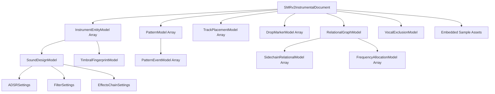

# Sonara Instrumental Representation (SMR v2.0 / SIR) Specification

**Version:** 2.0.0  
**Status:** Canonical Standard  
**MIME Type:** `application/vnd.sonara.smr+zip`  
**Container Extension:** `.smr`  
**Primary Engine:** Sonara SIR Core  

---

## 1. Executive Vision: Binary Equivalence in Musical Systems

In computing, binary representation ($0$ and $1$) does not merely serialize visual graphics or raw sound waveforms; it encodes the fundamental logic, control flow, instruction sets, register states, and data structures necessary to execute any computation across arbitrary hardware. 

Standard musical digital formats have historically suffered from a false dichotomy:
1. **Raw Audio Waveforms (`.wav`, `.flac`, `.mp3`)**: Monolithic, flat audio arrays that preserve sound perfectly but offer zero semantic interpretability, no programmatic access to individual musical voices, no parametric editability, and no structural understanding.
2. **Symbolic Note Sequences (`.mid`)**: Abstract integer pitches and event ticks that capture basic note sequences while completely discarding sound design, synthesis topology, dynamic timbre, filter movement, sample chopping, psychoacoustic sidechain compression, and mixing production.

**Sonara Instrumental Representation (SMR v2.0 / SIR)** resolves this breakdown by establishing a comprehensive, machine-readable format that represents every meaningful dimension of an instrumental piece. It models music not as a static waveform or a list of notes, but as a **computational execution graph**: atomic micro-events feed into parametric sound design nodes, organized into reusable subroutine patterns, scheduled along an arrangement timeline, linked through a relational mixing bus, and supplemented with direct audio payloads where non-symbolic sounds demand continuous fidelity.

### Scope Boundary: Strict Lead Vocal Exclusion
The SMR v2.0 specification is bounded to the **complete instrumental musical composition and production architecture**. The lead singer's vocal performance is decoupled and excluded from the target representation. All backing instrumentation, orchestral sections, drum hits, percussion rhythms, sub-bass movements, chord progressions, synth leads, vocoders, and pitched vocal chops functioning as rhythmic or harmonic instruments are fully preserved.

---

## 2. Computational Architecture Mapping

The SMR v2.0 format maps directly onto modern computing paradigms:

| Computing Architecture Concept | Sonara Instrumental Representation (SMR v2.0) | Functional Implementation |
| :--- | :--- | :--- |
| **Bitstream / Microcode** | **Micro-Event Bitstream** | `PatternEventModel` (beat offset, duration, pitch, velocity, micro-timing swing, transient sharpness) |
| **Hardware Execution Unit (ALU/FPU)** | **Sound Design Entity Nodes** | `SoundDesignModel` (oscillator topology, 4-stage ADSR, 24dB filters, harmonic drive, panning) |
| **Subroutines / Callable Functions** | **Reusable Musical Patterns** | `PatternModel` (bar-relative looping motifs, meter signatures, quantized event arrays) |
| **Instruction Pointer / Program Counter** | **Arrangement Placement Timeline** | `TrackPlacementModel` (bar index, repetition count, mute masks, section gain trim) |
| **Hardware Interrupts / Branching** | **Transition & Drop Architecture** | `DropMarkerModel` (drop impact coordinates, breakdown cutouts, entering/muted instrument masks) |
| **System Bus & Cache Coherency** | **Relational Interaction Graph** | `RelationalGraphModel` (sidechain compression network, frequency domain allocations) |
| **Direct Memory Access (DMA) Buffers** | **Embedded Audio Asset Payloads** | `assets/samples/*.wav` (raw audio slices for chopped samples, vocoders, and non-symbolic textures) |
| **Access Control / Memory Boundary** | **Vocal Exclusion Audit** | `VocalExclusionModel` (formal verification of lead vocal suppression and chop retention) |

---

## 3. Data Model Hierarchy & Schema Definition

The master schema is implemented in `sonara.representation.instrumental_schema` using validated Pydantic v2 data models.



### 3.1 Micro-Events (`PatternEventModel`)
Every musical note or percussive strike is represented as an atomic micro-event positioned relative to its parent pattern:
- `event_id`: Unique identifier within pattern.
- `start_beat`: Float position in musical beats relative to pattern start (e.g., `0.0`, `1.5`, `2.75`).
- `duration_beats`: Duration in musical beats.
- `pitch_midi`: General MIDI pitch integer `[0-127]` or `None` for unpitched percussion.
- `pitch_cents`: Detune deviation `[-50.0, +50.0]` for microtonal subtleties.
- `velocity`: MIDI dynamic intensity `[1-127]`.
- `micro_timing_offset_ms`: Humanized groove push/pull in milliseconds (preserves swing and pocket).
- `transient_sharpness`: Normalized attack steepness `[0.0, 1.0]`.

### 3.2 Sound Design Nodes (`SoundDesignModel`)
Instruments are defined not by static labels, but by their mathematical and synthesis parameters:
- `generator_type`: Engine enum (`analog_subtractive`, `wavetable_synth`, `sample_slicer`, `hybrid_dsp`, etc.).
- `oscillator_topology`: Waveform combinations (e.g., `saw_sub_sine`, `pitch_swept_sine`, `dual_sine_filtered_noise`).
- `envelope`: 4-stage ADSR curve:
  - `attack_ms`: Attack time in ms.
  - `decay_ms`: Decay time in ms.
  - `sustain_level`: Normalized sustain amplitude `[0.0, 1.0]`.
  - `release_ms`: Release time in ms.
- `filter`: DSP frequency boundary:
  - `filter_type`: Topology (`lowpass_24db`, `bandpass_12db`, `highpass_12db`).
  - `cutoff_hz`: Center cutoff frequency `[20.0, 22050.0]`.
  - `resonance_q`: Resonance peak `[0.1, 18.0]`.
- `effects`: Production chain:
  - `drive_saturation`: Non-linear harmonic saturation `[0.0, 1.0]`.
  - `reverb_send` & `reverb_room_size_ms`: Acoustic space simulation.
  - `sidechain_source`: Trigger instrument ID driving automatic gain ducking.
  - `sidechain_duck_db`: Gain reduction depth during trigger events (e.g. `-3.8 dB`).
  - `sidechain_release_ms`: Exponential recovery time (e.g. `65.0 ms`).

### 3.3 Reusable Patterns (`PatternModel`)
Musical motifs are modular subroutines. A 2-bar kick pattern or a 4-bar chord progression is stored once and referenced multiple times across the arrangement:
- `pattern_id`: Unique key (e.g., `pat_kick_syncopated_groove`).
- `length_bars`: Whole bar duration (e.g., `1`, `2`, `4`).
- `time_signature`: Meter signature (default `"4/4"`).
- `events`: Array of `PatternEventModel` instances.

### 3.4 Arrangement Placements (`TrackPlacementModel`)
The arrangement timeline instantiates patterns across bars:
- `placement_id`: Unique timeline marker.
- `instrument_id`: Instrument entity executing the pattern.
- `pattern_id`: Reusable pattern being triggered.
- `start_bar`: 1-based bar index where playback starts.
- `repeat_count`: Consecutive loop repetitions.
- `mute_mask_beats`: Array of pattern beats muted for fills or drops.
- `gain_offset_db`: Section-specific dynamic volume trim.

### 3.5 Transitions & Drops (`DropMarkerModel`)
Formal impact transitions are explicitly registered to eliminate arrangement ambiguity:
- `bar_index`: Exact bar where the drop or breakdown occurs.
- `time_seconds`: Timestamp in seconds.
- `transition_type`: Enum (`drop_impact`, `breakdown_dropout`, `build_riser`, `section_transition`).
- `impact_intensity`: Perceptual dynamic weight `[0.0, 1.0]`.
- `muted_instruments`: Array of instrument IDs silenced during breakdown.
- `entering_instruments`: Array of instrument IDs slamming in on drop downbeat.

### 3.6 Relational Graph (`RelationalGraphModel`)
Mix interactions operate beyond individual channels:
- `sidechain_network`: Directed graph of gain reduction links (e.g., Kick $\rightarrow$ Sub-Bass, Kick $\rightarrow$ Strings).
- `frequency_allocations`: Non-overlapping spectral domain budgets allocated per instrument.
- `kick_bass_synchrony_ratio`: Harmonic alignment factor between kick transients and bass root notes.

### 3.7 Vocal Exclusion Audit (`VocalExclusionModel`)
Verifiable boundary ensuring clean separation:
- `is_lead_vocal_excluded`: Strict boolean `True`.
- `isolation_method`: Decoupling method (`source_separation_spectral_decoupling`).
- `suppression_depth_db`: Decoupling attenuation in dB (e.g. `-42.0 dB`).
- `retained_instrumental_vocal_elements`: Non-lead vocal elements retained as sound design assets (e.g. vocoders, background chops).

---

## 4. Container Package Specification (`.smr`)

An SMR package is an open, unencrypted, compressed archive bundling the structured JSON document and binary audio payloads.

### 4.1 Archive Layout
```
package.smr
├── manifest.json              # Package metadata and SHA-256 asset checksums
├── instrumental.json          # Complete validated SMRv2InstrumentalDocument
└── assets/
    ├── samples/               # Embedded audio slices (.wav)
    │   ├── strings_riff.wav
    │   └── vocal_chop_lead.wav
    └── patterns/              # Optional standard MIDI sequences (.mid)
        ├── pat_kick.mid
        └── pat_bass.mid
```

### 4.2 Manifest Specification (`manifest.json`)
```json
{
  "format_version": "2.0.0",
  "generator": "Sonara SMR v2.0 Engine",
  "track_title": "Flashing Lights (Instrumental)",
  "master_bpm": 90.0,
  "master_key": "F# minor",
  "duration_seconds": 237.4,
  "total_bars": 90,
  "lead_vocal_excluded": true,
  "asset_checksums": {
    "instrumental.json": "8f3b...e4a1",
    "assets/samples/strings_riff_master.wav": "c1a9...5d22"
  }
}
```

---

## 5. Programmable Manipulation API (`InstrumentalTransformer`)

The SMR v2.0 representation is fully mutable and programmable via `sonara.representation.transformer.InstrumentalTransformer`.

### 5.1 Key Operations

```python
from sonara.representation.package import SMRPackage
from sonara.representation.transformer import InstrumentalTransformer, InstrumentalSynthesizer

# 1. Load Package
pkg = SMRPackage.load_package("output/flashing_lights/flashing_lights_v2.smr")
doc = pkg.document

# 2. Transpose Key (+2 Semitones: F# minor -> G# minor)
# Shifts bass and melodic patterns while leaving unpitched percussion untouched
transposed_doc = InstrumentalTransformer.transpose(doc, semitones=2)

# 3. Time-Stretch Tempo (90 BPM -> 120 BPM)
# Event beat coordinates are invariant; recalculates total duration and drop seconds
stretched_doc = InstrumentalTransformer.time_stretch(transposed_doc, new_bpm=120.0)

# 4. Swap Instrument Sound Design (Replace Sub-Bass with 303 Acid Bass)
from sonara.representation.instrumental_schema import SoundDesignModel, FilterSettings, EffectsChainSettings
acid_bass = SoundDesignModel(
    oscillator_topology="acid_saw_303",
    filter=FilterSettings(filter_type="lowpass_24db", cutoff_hz=750.0, resonance_q=12.0),
    effects=EffectsChainSettings(drive_saturation=0.85)
)
remixed_doc = InstrumentalTransformer.swap_instrument_sound(stretched_doc, "inst_sub_bass", acid_bass)

# 5. Full Instrumental Audio Reconstruction
synth = InstrumentalSynthesizer(sample_rate=44100)
reconstructed_stereo_audio = synth.render(remixed_doc, package=pkg)
```

---

## 6. Verification and Compliance Standards

Every conforming SMR v2.0 document and container must satisfy:
1. **Schema Conformity**: Validates against Pydantic v2 `SMRv2InstrumentalDocument`.
2. **Audio Integrity**: Any referenced `sample_asset_ref` must resolve to a valid file in `assets/samples/` matching its SHA-256 checksum in `manifest.json`.
3. **Beat-Invariance**: All `start_beat` and `duration_beats` values must be strictly positive floats in musical meter units, independent of project tempo.
4. **Vocal Boundary**: `vocal_exclusion.is_lead_vocal_excluded` must evaluate to `True`. Lead vocal frequency content must be verified decoupled.
5. **Reconstruction Completeness**: Executing `InstrumentalSynthesizer.render(doc)` must produce a continuous stereo waveform matching `total_duration_seconds` without missing tracks or NaN overflows.
